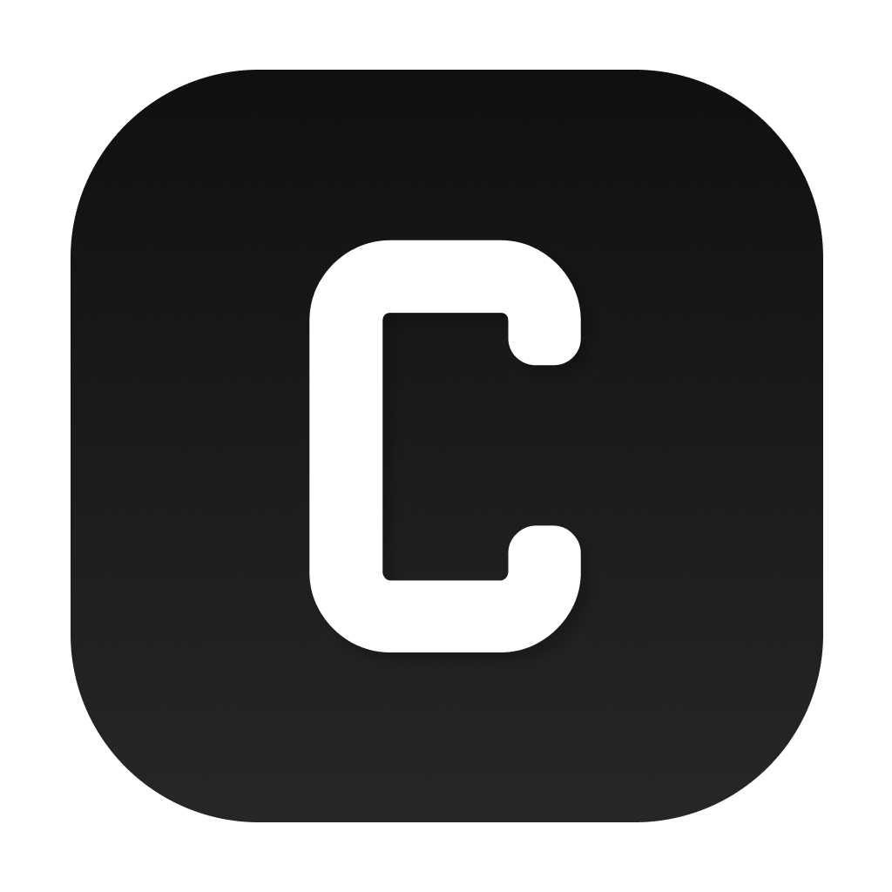

  

<h1 align="center">Poratake</h1>

  <strong>Capture anything. Keep the moment.</strong> 
  A native Rust + GPUI screenshot and screen recording studio for macOS, Windows, and Linux. Capture, annotate, record, edit, understand, and share without Electron or a Chromium runtime.

  <a href="https://porabuild.com/poratake">Website</a> · <a href="https://github.com/Porabuild/Poratake/releases">Releases</a> · <a href="https://github.com/Porabuild/Poratake/issues">Report a Bug</a> · <a href="https://github.com/Porabuild/Poratake/issues">Request a Feature</a>

  <em>Free and open source under the GNU AGPL v3.0</em>

---

  

## Why Poratake?

Capturing something should not turn into a chain of disconnected tools. Poratake keeps screenshots, recordings, annotation, OCR, transcription, editing, and export in one focused workflow.

### Capture Exactly What You Need

Capture a full display, a window, or a precise area. Freeze the desktop when the moment cannot move, set a timer, capture a scrolling page, pick a color, or use the all-in-one panel when you want every tool close at hand.

### A Complete Screenshot Editor

Draw with pen and highlighter tools, add shapes, arrows, text, and numbered steps, redact sensitive details, crop the result, and present it against a polished wallpaper or window frame.

### Recording That Stays on Target

Record a display, area, or individual window with microphone, system audio, camera, and cursor tracking. A selected window remains the recording target when it moves, resizes, or passes behind another window.

### A Video Editor Built In

Trim recordings and shape the final story with cursor controls, Auto Zoom, drawings, camera, audio, wallpaper, keyboard events, subtitles, and a custom first frame. Preview and export share the same composition pipeline.

### Turn Pixels Into Information

Extract text with OCR, scan QR codes, and transcribe recordings locally without leaving the capture workflow.

### History, Pinning, and Sharing

Return to earlier captures, filter and sort them, and use History Polish before sharing. Pin a resizable capture above other windows, copy or save it, print it, choose from 13 paired light/dark themes, or upload it through your own S3 or REST provider.

## Built Native: Fast, Lightweight, and Cross-Platform

Poratake's architecture is visible in the repository: native capture and rendering paths, explicit memory reclamation, and no embedded browser shell.

### Zero Electron / Native Cross-Platform Architecture

Poratake is a single Rust GPUI desktop app (`src/main/app-gpui/`) paired with native OS daemons: a compiled zero-dependency Swift daemon on macOS (`src/main/daemon/`), Rust on Windows (`src/main/daemon-win/`), and Rust on Linux (`src/main/daemon-linux/`). They communicate over the typed JSON-RPC protocol shared in `src/main/daemon-common/` and generated from `src/types/daemon-contract.json`. The shipped app does not embed an Electron, Chromium, or Node.js runtime.

### Low Memory Footprint & Active Idle Reclaim

Release binaries compile with size optimization (`opt-level = "z"`), LTO, stripped symbols, and abort-on-panic in `src/main/Cargo.toml`. After 5 seconds of idle time, Poratake clears transient SVG, gradient, cursor-sprite, and preview caches, discards idle preview windows, and returns freed heap pages to the OS with `malloc_zone_pressure_relief` on macOS, `malloc_trim` on glibc Linux, and `HeapCompact`, `_heapmin`, and working-set trimming on Windows. Vendored Metal and DirectX GPUI patches also release unused GPU path textures and pause hidden display links.

### Fast & Responsive Capture

Capture overlays are prewarmed and reused, and the persistent native daemon process is supervised and restarted rather than cold-started for each screenshot. GPU-accelerated UI rendering — Metal on macOS, Direct3D 11 on Windows, and GPUI's GPU backend on Linux — keeps canvas drawing, annotation selection, and video timeline scrubbing responsive.

### Hardware-Accelerated Capture, HDR, and Encoding

macOS combines ScreenCaptureKit capture, VideoToolbox H.264 encoding (`h264_videotoolbox`), and Apple Vision OCR and QR scanning. Windows uses Windows Graphics Capture with Direct3D 11; HDR capture uses the native scRGB path and GPU tone mapping calibrated to each display's live transfer curve, while Media Foundation H.264 encoding enables hardware transforms and uses DXGI device management for capture, and `Windows.Media.Ocr` handles OCR. Linux uses native X11 (`xcb`) capture and the Wayland XDG Desktop Portal ScreenCast path.

### Private & Offline-First

OCR, QR scanning, and local `whisper.cpp` speech-to-text run on-device, with base, small, and medium models downloaded on demand. Poratake has no telemetry or analytics. Cloud uploads go only to user-configured S3-compatible or REST endpoints.

## What Ships Today

| Workflow                   | Capabilities                                                                                                                                                                                   |
| -------------------------- | ---------------------------------------------------------------------------------------------------------------------------------------------------------------------------------------------- |
| Capture                    | Full screen, area, window, freeze screen, timer, scroll capture, color picker, display/window selectors, all-in-one panel, and print                                                           |
| Understand                 | On-device OCR, QR scanning, and local `whisper.cpp` transcription (base, small, medium models)                                                                                                 |
| Record                     | Screen, area, window, camera, microphone, system audio, cursor tracking, HDR-calibrated Windows capture, and live controls                                                                     |
| Screenshot editor          | Pen, highlight, shapes, arrows, text, numbering, redaction, crop, wallpaper, and window frames                                                                                                 |
| Video editor               | Cursor, Auto Zoom, drawing, camera, audio tracks, wallpaper, keyboard events, subtitles, first frame, MP4 and GIF export (shared preview/export pipeline)                                      |
| Desktop, themes, and share | History with filtering/sorting/Polish, resizable pinned captures, desktop icons and wallpaper, 13 paired light/dark themes, BYO S3/REST cloud upload, SHA-512 verified updates, copy, and save |

## Platforms

| Platform                      | Support and packaging                                                                                                                                                                                                                                                                                                                                                                                                                                        |
| ----------------------------- | ------------------------------------------------------------------------------------------------------------------------------------------------------------------------------------------------------------------------------------------------------------------------------------------------------------------------------------------------------------------------------------------------------------------------------------------------------------ |
| macOS                         | macOS 15 or later on Apple Silicon and Intel, shipped as a universal `.dmg` and `.zip`; full feature set (18/18 capabilities)                                                                                                                                                                                                                                                                                                                                |
| Windows                       | Windows 10/11 on `x64` and `arm64`, shipped as a Velopack installer; full feature set except the macOS-only capture sound (17/18), including HDR-calibrated capture and GPU tone mapping                                                                                                                                                                                                                                                                     |
| Linux (X11)                   | `x86_64` and `aarch64`, shipped as `.deb` and `.tar.gz`; screen, area, window, freeze, timer, and scroll capture, color picker, QR scanning, recording (when system FFmpeg supports H.264), screenshot and video editors, history, pin, print, cloud upload, and global shortcuts; no OCR, transcription, capture sound, or desktop-icons toggle                                                                                                             |
| Linux (Wayland / Omarchy 4.5) | `x86_64` and `aarch64`, installed with `packaging/omarchy/install.sh` or shipped as `.deb` and `.tar.gz`; screen and area screenshots through the ScreenCast portal, QR scanning, all-in-one panel, screenshot and video editors, history, pin, print, cloud upload, and Hyprland autostart/bindings. Verified on GNOME Wayland, with the Hyprland pass pending; recording and window capture are not yet available. See [docs/omarchy.md](docs/omarchy.md). |

## Install

The current release is `v1.0.6`. Published installers are distributed through the [GitHub releases page](https://github.com/Porabuild/Poratake/releases), with corresponding source published alongside every release.

- macOS: universal `.dmg` and `.zip`
- Windows: `x64` and `arm64` Velopack installers
- Linux: `x64` and `arm64` `.deb` and `.tar.gz` archives
- Omarchy or Arch Linux: `packaging/omarchy/install.sh`; see [docs/omarchy.md](docs/omarchy.md)

To build Poratake locally, follow the setup and native build instructions in [CONTRIBUTING.md](CONTRIBUTING.md).

## Contributing

Contributions are welcome. Please open an [issue](https://github.com/Porabuild/Poratake/issues) before starting a substantial change so the approach and scope can be discussed first. Rust UI dependency fixes and GPUI upgrades must follow [docs/gpui-vendoring.md](docs/gpui-vendoring.md).

## License and Attribution

Poratake is a modified version of [Capty](https://github.com/capty-app/capty). Poratake modifications were made in 2026.

Copyright (C) 2026 Capty.

Copyright (C) 2026 Serhii Vecherenko for Poratake modifications. Poratake is a Porabuild project. Copyright in other contributions remains with their respective contributors.

Poratake is licensed as a whole under the [GNU AGPL v3.0](LICENSE), without warranty of any kind. You may redistribute it under the same license. Corresponding source for Poratake releases is available from this repository; release downloads and their source are published together on the [releases page](https://github.com/Porabuild/Poratake/releases).

Poratake bundles components under compatible licenses, including FFmpeg under the LGPL v2.1, whisper.cpp under the MIT License, and Geist under the SIL Open Font License 1.1. See [THIRD_PARTY_NOTICES.md](THIRD_PARTY_NOTICES.md) for copyright notices, exact versions, source details, and license terms.
